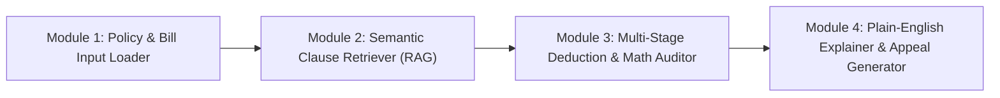

# DocuClaim: RAG-Driven Health Insurance Policy Triage & Dispute Assistant

**Team PromptCraft** | **Team ID: `PE-B13-57`**  
**Team Members:** Aagam Jain (`S24CSEU0263`), Riya Tyagi (`S24CSEU0280`), Shubhashni Kant (`S24CSEU0535`)  
**Course:** SCSE4041 Prompt Engineering | **Batch Group:** B13-24  
**Model:** Google `gemini-2.5-flash` via `google-genai` SDK  

---

## 📌 Executive Overview

**DocuClaim** is an enterprise-grade AI forensic audit and grievance redressal system for health insurance claims. When hospital bills are settled, Third-Party Administrators (TPAs) and insurers frequently apply **proportionate room rent deductions** across the entire bill—unlawfully deducting non-associated expenses like pharmacy, medicines, and consumables in direct contravention of policy terms and IRDAI regulations.

DocuClaim automates the forensic review process:
1. **RAG Context Grounding**: Semantically retrieves the exact policy clauses governing room rent limits, ICU caps, and pre-existing disease (PED) waiting periods.
2. **3-Stage Sequential Prompt Pipeline**: Deconstructs noisy hospital bills into structured financial entities, performs step-by-step ratio arithmetic with strict negative constraints, and enforces statutory exemptions.
3. **Dual-Audience Generation**: Translates complex forensic findings into an 8th-grade reading level plain-English summary for the patient and a formal, citation-backed legal appeal letter for the Grievance Redressal Officer (GRO).

---

## 🏗️ 4-Module System Architecture

The application interface is structured into four core modules:



### Module 1: Policy Clause & Hospital Bill Input Loader
- **Dual Side-by-Side Ingestion**:
  - **Left Column**: Policy document loader supporting `.pdf` drag-and-drop extraction via `pypdf` or direct editing of pre-filled standard clauses (Clause 4.1 Room Rent & Pharmacy Exemption, Clause 4.2 ICU Cap, Clause 7.1 Accidental Waiver, Clause 7.2 36-Month PED Waiting Period, Clause 8.4 Grievance Redressal).
  - **Right Column**: Itemized hospital bill and TPA settlement sheet text area with line-item breakdowns, room rent tariffs, billed/settled amounts, and deduction remarks.

### Module 2: Semantic Clause Retriever (RAG Context Grounding)
- **Local Chunking & TF-IDF Vectorization**: Policy text is chunked into semantic clause units and indexed using `scikit-learn` TF-IDF and Cosine Similarity.
- **Top-3 Grounded Relevance**: Ranks and displays the Top-3 most relevant clauses against the hospital bill with percentage relevance badges (e.g., `Clause 4.1 Room Rent [Relevance: 88%]`) to anchor the downstream audit.

### Module 3: Multi-Stage Deduction & Proportionate Math Auditor
- **Executive Metric Cards**: Displays `Total Billed`, `Total Settled`, `Disputed / Recoverable Amount`, and `Proportionate Ratio`.
- **Itemized Audit Table**: Renders every line item with color-coded status badges:
  - `VALID` (Green): Contractual deductions (e.g., room rent cap or ICU sub-limit).
  - `INVALID` (Red): Unlawful deductions (e.g., proportionate cuts applied to exempt pharmacy lines, or PED rejections past the 36-month waiting period).
  - `INSUFFICIENT_CLAUSE_DATA` (Amber): Safety guardrail triggered when a billed item (e.g., Air Ambulance) has no corresponding clause in the policy wording.
- **Auditable Prompt Chain Inspector**: Expandable viewer revealing the raw intermediate JSON outputs from **Prompt 1 (Entity Extractor)** and **Prompt 2 (CoT Math Auditor)**.

### Module 4: Plain-English Explainer & Formal Appeal Letter Generator
- **Patient-Friendly Summary**: A compassionate, jargon-free explanation written at an 8th-grade reading level highlighting what was charged, why cuts were unfair, and what money can be reclaimed.
- **Formal Grievance Redressal Appeal Letter**: A ready-to-mail legal representation addressed to the Grievance Redressal Officer (GRO) citing exact clause numbers, IRDAI master circular standards, and step-by-step arithmetic ratio proofs.
- **One-Click Export**: Downloadable as `DocuClaim_Grievance_Appeal.txt` with an in-app clipboard copy option.

---

## ⚡ Prompt Pipeline Modes: Baseline vs. Production Chained

DocuClaim features a sidebar toggle allowing evaluators to directly compare prompt engineering approaches:

| Feature | Mode A — v1: Zero-Shot Baseline | Mode B — v4: Production 3-Stage Pipeline |
| :--- | :--- | :--- |
| **Pipeline Architecture** | Single-turn zero-shot prompt | Sequential 3-stage LLM pipeline with intermediate JSON handoffs |
| **Model & Parameters** | `gemini-2.5-flash` | `gemini-2.5-flash` (`temp=0.1`, `response_mime_type="application/json"`) |
| **Entity Extraction** | None (Direct textual response) | Stage 1 isolates financial entities, line items, and tariffs |
| **Room Rent Math** | Prone to hallucinations and ratio errors | Stage 2 computes $\frac{\text{Eligible Room Limit}}{\text{Actual Room Rent}}$ step-by-step |
| **Exemption Handling** | Frequently misses pharmacy/medicine exemptions | Stage 2 prioritizes explicit exemptions before applying cuts |
| **Missing Clause Guardrail** | Guesses or invents validity | Strictly flags `INSUFFICIENT_CLAUSE_DATA` |
| **Deliverables** | Raw unstructured text + 2-sentence generic appeal | Color-coded audit table, 8th-grade patient summary, and formal GRO letter |

---

## 📂 Built-in Synthetic Preset Scenarios

DocuClaim includes 4 built-in 1-click presets covering critical FinTech and health insurance edge cases, plus 8 additional test scenarios in `data/synthetic_test_cases.json`:

1. **Preset 1: Room Rent Breach + Wrongful Pharmacy Deduction (Disputable)**
   - *Scenario*: Insured stayed in a room tariff of ₹10,000/day against a ₹5,000/day (1%) cap. Insurer settled room rent and doctor fees at 50%, but unlawfully applied a 50% cut to ₹25,000 in pharmacy expenses.
   - *Audit Verdict*: Room and doctor fee deductions are `VALID`. Pharmacy deduction of ₹12,500 is `INVALID` (exempt under Clause 4.1). Total Recoverable: **₹12,500**.
2. **Preset 2: Pre-Existing Disease (PED) 40-Month Tenure (Invalid Rejection)**
   - *Scenario*: Claim of ₹85,000 repudiated citing 36-month PED waiting period clause (Clause 7.2). Policy tenure is 40 continuous months.
   - *Audit Verdict*: Entire repudiation is `INVALID` as tenure (40 months) exceeds the waiting period (36 months). Total Recoverable: **₹85,000**.
3. **Preset 3: Valid ICU Sub-Limit Cap Deduction (Valid Deduction)**
   - *Scenario*: Sum Insured ₹4,00,000 with 2% daily ICU cap (₹8,000/day). Patient billed ₹12,000/day for 4 days. Insurer deducted ₹16,000.
   - *Audit Verdict*: ICU deduction of ₹16,000 is `VALID` under Clause 4.2. Total Recoverable: **₹0**.
4. **Preset 4: Missing Air Ambulance Clause Edge Case (Insufficient Data Guardrail)**
   - *Scenario*: Bill contains an Air Ambulance evacuation charge of ₹1,50,000. Provided policy wording does not contain an aeromedical clause.
   - *Audit Verdict*: Flags `INSUFFICIENT_CLAUSE_DATA` citing missing add-on policy schedule. Total Recoverable: **₹0 (Guardrail Triggered)**.

---

## 🚀 Quickstart & Installation

### Prerequisites
- Python 3.10, 3.11, or 3.12
- Recommended: Virtual environment (`venv`)

### 1. Clone & Navigate to Repository
```bash
git clone <repo-url>
cd Prompt_proejct
```

### 2. Set Up Virtual Environment & Dependencies
```bash
python3 -m venv .venv
source .venv/bin/activate
pip install -r requirements.txt
```

### 3. (Optional) Configure Gemini API Key
You can pass your API key via environment variable:
```bash
export GEMINI_API_KEY="your-gemini-api-key-here"
```
*Note: If no API key is provided, DocuClaim automatically runs in **Smart Offline Adjudication Mode**, allowing full deterministic evaluation of all presets with zero setup delay.*

### 4. Launch the Streamlit Application
```bash
streamlit run app.py
```
The application will open in your default browser at `http://localhost:8501`.

---

## 📁 Repository Structure

```text
├── app.py                              # Complete self-contained Streamlit application
├── requirements.txt                    # Project dependencies (streamlit, google-genai, etc.)
├── README.md                           # Comprehensive documentation & setup instructions
├── sample_policy.pdf                   # Test PDF policy wording for uploader verification
├── prompts/
│   └── prompt_iterations_v1_to_v4.md   # Evolutionary documentation of Prompts v1 to v4
└── data/
    └── synthetic_test_cases.json       # All 12 synthetic test scenarios with ground truth
```

---

## 👥 Team PromptCraft Credits

- **Team ID**: `PE-B13-57`
- **Batch Group**: `B13-24`
- **Course**: `SCSE4041 Prompt Engineering`
- **Team Members**:
  - **Aagam Jain** (`S24CSEU0263`)
  - **Riya Tyagi** (`S24CSEU0280`)
  - **Shubhashni Kant** (`S24CSEU0535`)
- **Developed for**: GenAI Health Insurance Triage & Dispute Resolution
